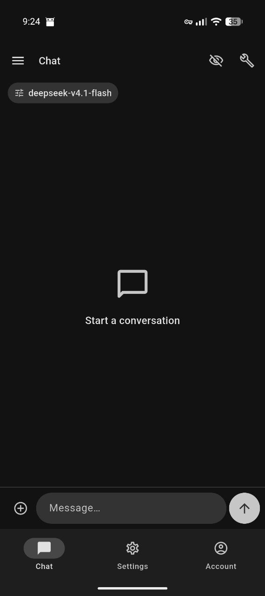
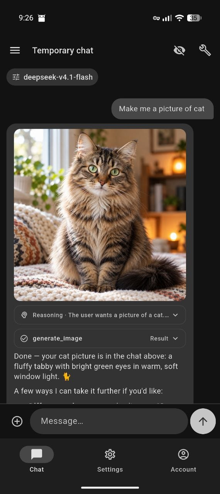
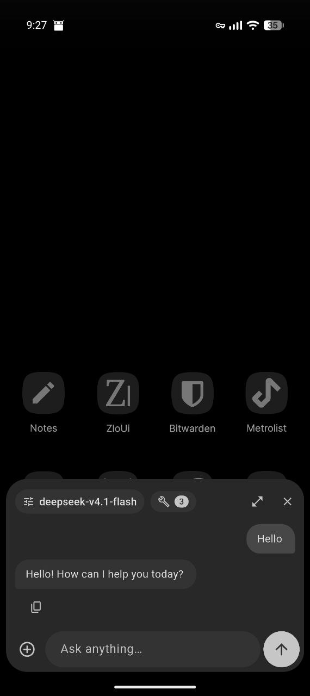

# ZloUi

A sleek Material You client for self-hosted [Open WebUI](https://openwebui.com) instances.

## Screenshots

<p>



</p>

## Features

- Chats with history, search, pinning, archiving, renaming and cloning
- Temporary chats that are not saved on the server
- Model picker, web search, code interpreter, image generation, memory and tools (including MCP servers) configured on the server
- Markdown replies, reasoning and tool call blocks, tappable source references
- Generated and attached images: full screen view, zoom, save
- Questions from the model (`ask_user`) answered inside the chat
- Digital assistant: a floating chat window you can open from any screen, with a button to continue the conversation in the app
- Material You or custom accent colors, light and dark themes
- English and Russian interface (follows the system language by default)

## Building

Requirements: the [Flutter SDK](https://docs.flutter.dev/get-started/install)
(stable) and a JDK 17 (a full JDK with `javac`, not only a JRE).

```sh
flutter pub get
flutter build apk --release --split-per-abi
```

APKs are written to `build/app/outputs/flutter-apk/`. Pick the one that matches
your device (usually `arm64-v8a`).

Release builds are signed with the debug key unless you change
`android/app/build.gradle.kts`. F-Droid re-signs releases with its own key.